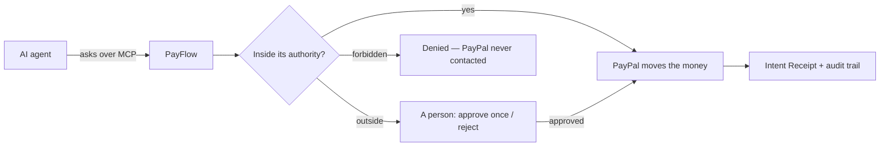

<p align="center">
  <picture>
    <source media="(prefers-color-scheme: dark)" srcset="docs/assets/payflow-logo-dark.svg">
    
  </picture>
</p>

<h3 align="center">Financial authority for AI agents.</h3>

<p align="center">
AI agents shouldn&rsquo;t need unrestricted payment credentials.<br>
Give them <b>permission to ask</b>. PayFlow decides whether each request is inside the authority you delegated. PayPal moves the money.
</p>

<p align="center">
<b>AI can ask. &nbsp;→&nbsp; PayFlow decides. &nbsp;→&nbsp; PayPal moves the money.</b>
</p>

<p align="center">
PayPal AI Hackathon 2026 · PayPal <b>Sandbox</b> only — no real money · MIT licensed<br>
<a href="docs/JUDGE_TESTING.md"><b>Try it (judge guide)</b></a> &nbsp;·&nbsp; <a href="docs/DEPLOYMENT.md">Deployment</a> &nbsp;·&nbsp; <a href="ARCHITECTURE.md">Architecture</a> &nbsp;·&nbsp; <a href="docs/SECURITY.md">Security</a>
</p>

---

## One agent, four requests

**Authority:** the *Cloud Procurement Agent* may ask to pay **Acme Cloud** and **AWS**, in **USD**, up to **$500** each and $5,000 a month, for **cloud infrastructure**. Never *Blocked Vendor*.

| The agent asks | Checks | PayFlow decides |
|---|---|---|
| **$185** → Acme Cloud · GPU compute | Supplier ✓ Currency ✓ Amount ✓ Budget ✓ Purpose ✓ | ✅ **Allowed** — PayPal pays |
| **$470** → Acme Cloud · digital gift cards | Supplier ✓ Currency ✓ Amount ✓ Budget ✓ **Purpose ✕** | ⏸ **A person decides** — outside the purpose this agent was authorized for |
| **$650** → AWS · cloud compute | Supplier ✓ Currency ✓ **Amount ✕** Purpose ✓ | ⏸ **A person decides** — $150 over its limit. *Approve once*; the authority doesn&rsquo;t change |
| **$120** → Blocked Vendor | **Supplier ✕** | ⛔ **Denied** — PayPal is never contacted |

The $470 request is not "fraud detection": the request *states* its purpose (gift cards), and that purpose is outside what the authority was delegated for. That is **semantic authorization** — limits *and* meaning. Every row is reproducible in the app with a **Test run** (no money moves).

<p align="center"></p>

## Why not just give the agent a PayPal key?

A PayPal API credential grants access to the payment APIs — to pay anyone, any amount, for anything, with no record of why. It can&rsquo;t express that *this* agent may pay only Acme Cloud or AWS, only in USD, only up to $500, only for cloud infrastructure, within a monthly budget, until a date — and that a person decides anything else.

PayFlow keeps the credential behind that boundary. **The agent holds permission to ask, not the ability to pay.** It can never:

- approve its own request,
- raise its limits or widen its authority,
- change the recipient or amount after a decision,
- reach PayPal or see any credential.

Revoke it, and its next call is refused — without rotating the merchant&rsquo;s keys.

## How it works



- **Agent** — an identity with permission to *ask* through specific workflows (PayFlow&rsquo;s own MCP server).
- **Authority** — what is permitted: what, to whom, how much, how often, for what purpose, until when. The ceiling for paying without a person.
- **Workflow** — what should happen when a request arrives (its own checks, AI evidence, approval steps). It can be stricter than its authority, never broader.
- **Approval** — one request, once. It never changes the authority.
- **Intent Receipt** — what was requested, by whom and why, which authority applied, who decided, and what PayPal reported — hash-linked and verified on every view.

**The language model never authorizes a payment and never moves money.** It reads invoices, checks purpose and drafts workflows; its output is *evidence* for deterministic policy, and the workflow validator rejects any graph where an AI output feeds an amount or recipient.

<p align="center"></p>

## Real PayPal Sandbox evidence

Labels in the app and in [`evidence/`](evidence) say where every record came from: **REAL_PAYPAL_SANDBOX**, **REAL_OPENAI**, **CACHED_AI_ANALYSIS**, **TEST_INPUT**, **MOCK_TEST**.

- **A settled agent payment, end to end** ([evidence](evidence/phase12/06-settled-proof)): the Cloud Procurement Agent asked over MCP for $15.00 to the AWS Demo Sandbox account → Intent Receipt → AI evidence → authority **ALLOW** (no person needed) → PayPal Payouts batch `PNEA99DU4KEVW` → PayPal's signed `PAYMENT.PAYOUTS-ITEM.SUCCEEDED` webhook, verified and confirmed with PayPal → **Settled**. PayPal's own API reports the item `SUCCESS`. PayFlow showed *Submitted to PayPal* until that confirmation arrived.
- **A person approving once** ([phase 9](evidence/phase9)): a $650 agent request over its $500 limit waited for a person, was approved once and paid. Those earlier payouts went to addresses that were not PayPal accounts, so PayPal reported them `UNCLAIMED` — PayFlow shows **Awaiting recipient**, not "paid".
- Real refunds (idempotent replay verified), invoices sent, paid and reconciled ([phase 5](evidence/phase5)); prompt-injection attempts ignored ([phase 4](evidence/phase4), [phase 7](evidence/phase7)); a draft evaluating real PayPal events without acting ([phase 8](evidence/phase8)).

<p align="center"></p>

## Safety model

- **Credentials stay inside PayFlow.** Agents hold a PayFlow credential (SHA-256 stored, rotatable, revocable, expiring) that only lets them ask.
- **Limits are code.** Amounts, budgets, currencies, allowlists and frequency are checked deterministically — exact decimals, budget reservations under row locks.
- **AI can raise concern, never lower it.** Invalid, uncertain or injected AI output goes to a person.
- **Approval is bound.** It covers the exact request it was shown; a changed request is blocked.
- **Checked again before sending.** Right before PayPal: the receipt is intact, the agent is still active, and the authority has not been suspended or expired.
- **No duplicate money movement.** Agent request ids, PayPal request ids and payout batch ids make retries safe; a lost PayPal reply is recovered, never re-sent blindly.
- **Tamper-evident audit.** Every record is hash-chained per workspace and verified on view. It is not externally anchored: it detects changes made through the application, not by someone who can rewrite the database.

## Test run and Observe Mode

A **Test run** sends a request through the real decision engine — same workflow version, authority, budget, AI evidence and approval rules — inside a database transaction that is always rolled back and cannot obtain a PayPal write capability. Every result says **PayPal not contacted · Money moved $0 · Real budget reserved $0**. It answers *"what would PayFlow decide under today&rsquo;s rules?"* — not what PayPal will do.

**Observe Mode** (advanced) lets a draft workflow evaluate real, PayPal-confirmed events without acting — never forecasting, never moving money.

## For engineers

**Agents (MCP):** `POST /api/mcp` (Streamable HTTP). Tools: `payflow_list_capabilities`, `payflow_request_payment`, `payflow_request_refund`, `payflow_test_request`, `payflow_get_request`, `payflow_get_authority`, `payflow_cancel_request`. No tool approves, edits rules or reaches PayPal.

**PayPal (Sandbox, real calls):** Payouts · Payments (capture refunds) · Orders (capture) · Invoicing (send, remind, reconcile) · Transaction Search · Webhooks (self-verified signatures, confirmed with PayPal&rsquo;s API, stored once per event) · Catalog/Plans — via the official `@paypal/paypal-server-sdk` and a typed REST client. [Capability map](docs/PAYPAL_CAPABILITY_MAP.md).

**AI:** OpenAI `gpt-5.4-mini` with Structured Outputs — a plain-English workflow compiler (asks when unclear, refuses ungated money paths, saves drafts only a person can activate), natural-language edits shown as exact diffs, and evidence nodes (invoice reading, purpose, contract, behaviour, invoice matching). Hard spend caps in code; analyses cached by content.

**Stack:** Next.js 16 · React 19 · TypeScript · PostgreSQL + Drizzle · pg-boss · React Flow · Tailwind CSS 4 · Vitest (315 tests against a real PostgreSQL) · Render Blueprint (`render.yaml`) · Cloudflare Tunnel for local webhooks. Development tooling (not part of the product): Claude Code, PayPal AI Toolkit and APIMatic Context plugins.

## Run it locally

Requires **Node 24** and **pnpm** (`corepack enable`). PostgreSQL is bundled (embedded, port 54329).

```bash
git clone https://github.com/LISK819129/Payflow.git
cd Payflow
pnpm install
pnpm env:init      # .env.local with generated local secrets and the local login
pnpm db:start      # terminal 1 — PostgreSQL; keep it running
```

```bash
pnpm db:migrate    # terminal 2
pnpm db:seed       # the demo workspace ("Demo Company") and its owner login (in .env.local)
pnpm demo:restore  # the demo workflows, authorities and the Cloud Procurement Agent
pnpm dev           # http://localhost:3000
```

```bash
pnpm worker:fresh  # terminal 3 — background jobs
```

Add PayPal **Sandbox** app credentials and an OpenAI key to `.env.local` (without them the app says *setup required* — it never fakes a response). Full walkthrough: **[docs/JUDGE_TESTING.md](docs/JUDGE_TESTING.md)**. Tests: `pnpm test`, `pnpm lint`, `pnpm typecheck`, `pnpm build`, `pnpm paypal:check`.

**Deployment:** a Render Blueprint (one web service, one worker, PostgreSQL) plus commands that configure and verify it without moving money — [docs/DEPLOYMENT.md](docs/DEPLOYMENT.md). The hosted instance runs during judging and may not be up when you read this.

## Limitations

- **Sandbox only.** PayFlow refuses to start against live PayPal.
- **Settlement status relies on PayPal&rsquo;s webhooks.** If a webhook never arrives, a payment stays *Submitted to PayPal* even after PayPal has paid it; there is no polling fallback yet.
- **Semantic authorization reads what the request says.** A dishonest agent can misstate its purpose; what still holds is the rest of the authority — approved recipients, limits, budget, frequency, approvals and revocation.
- **Two wordings must agree.** An authority only accepts a purpose check made against its own exact wording; if a compiled workflow words its purpose differently, payments wait for a person until the two match — the rule page says so and how to fix it.
- Disputes and the order-capture success path were not exercised end-to-end on Sandbox.
- One web instance (rate limits are per process); the audit chain is not externally anchored.

## License

[MIT](LICENSE) © 2026 Atul Krishna R. Fonts: Instrument Sans and IBM Plex Mono (SIL Open Font License); icons: Lucide (ISC). The PayFlow logo is original to this project. PayPal is a trademark of PayPal, Inc.; this project is not affiliated with or endorsed by PayPal.
