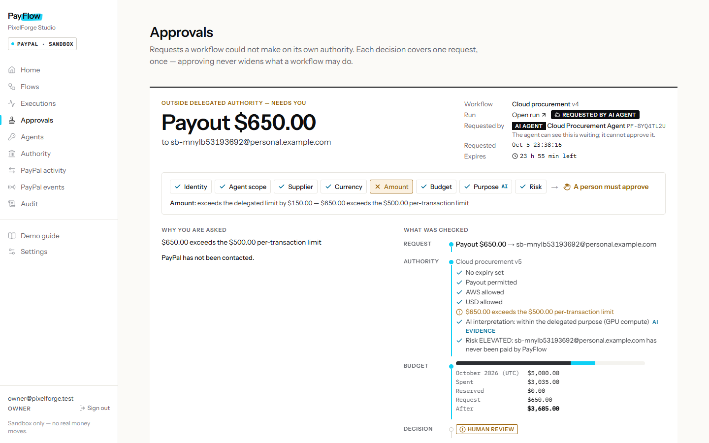
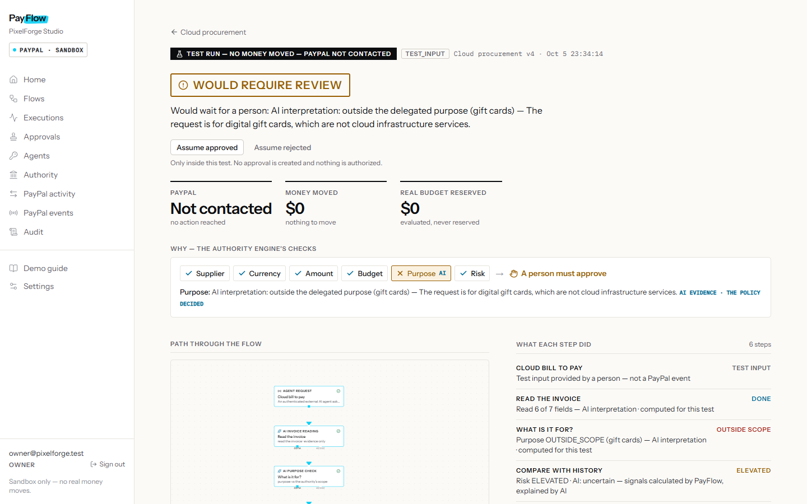
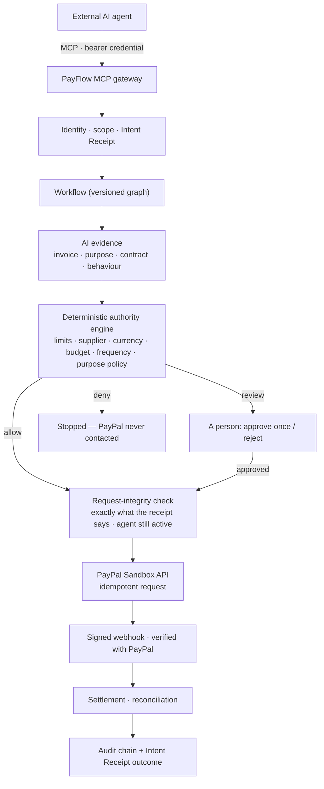
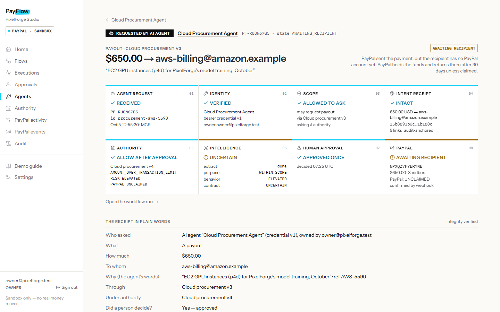
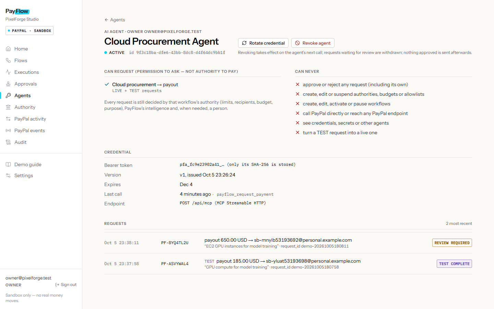

<p align="center">
  <picture>
    <source media="(prefers-color-scheme: dark)" srcset="docs/assets/payflow-logo-dark.svg">
    
  </picture>
</p>

<h3 align="center">Financial authority for AI agents.</h3>

<p align="center">
PayFlow sits between autonomous software and real money. Agents can request payouts and refunds, but PayFlow independently checks who is asking, what they are allowed to do, who they may pay, how much they may spend and what the payment is for — and whether a person needs to decide — before PayPal is contacted.
</p>

<p align="center">
<b>AI can ask. &nbsp;·&nbsp; PayFlow decides. &nbsp;·&nbsp; PayPal moves the money.</b>
</p>

<p align="center">
Built for the PayPal AI Hackathon 2026 · PayPal <b>Sandbox</b> only — no real money · MIT licensed
</p>

<p align="center">
<a href="docs/JUDGE_TESTING.md"><b>Judge testing guide</b></a> &nbsp;·&nbsp; <a href="docs/DEPLOYMENT.md">Deployment</a> &nbsp;·&nbsp; <a href="ARCHITECTURE.md">Architecture</a> &nbsp;·&nbsp; <a href="docs/SECURITY.md">Security</a> &nbsp;·&nbsp; <a href="BUILD_STATUS.md">Build log &amp; evidence</a>
</p>

<p align="center"></p>

---

## The problem

AI agents are becoming capable of doing useful work — buying cloud capacity, paying suppliers, refunding customers. The usual way to let them is to hand over payment credentials. But a PayPal token answers only one question:

> *Can this software call the API?*

It cannot answer the questions a finance team actually cares about:

> *Is **this** payment authorized — to this recipient, for this amount, for this purpose, within this month's budget — and does a person need to see it first?*

An agent with merchant credentials can pay anyone, any amount, for anything, and nothing remembers why.

## What PayFlow does

PayFlow gives agents and automated workflows **delegated financial authority** instead of credentials:

| | |
|---|---|
| **Explicit limits** | per-transaction maximum, currency, monthly budget, frequency, expiry |
| **Who may be paid** | supplier allowlists and deny lists |
| **What the money is for** | a plain-language purpose scope ("cloud infrastructure"), checked against the invoice and the request |
| **A person when it matters** | anything beyond the authority waits for a human — *approve once* or *reject*; approving never widens the authority |
| **AI as evidence** | AI reads invoices, checks purpose and contracts and explains behaviour — its output is evidence for deterministic rules, never a decision |
| **An agent gateway** | PayFlow's own MCP server: agents get an identity and narrow, revocable permission *to ask* |
| **Intent Receipts** | every agent request is hashed and anchored in the audit chain; the payment PayFlow makes must match it exactly |
| **Reconciliation** | status comes from PayPal's own confirmations (signed webhooks, verified with PayPal) — *submitted* is never shown as *settled* |
| **Audit** | a per-workspace, hash-chained, tamper-evident record of every decision |

## One example

The demo company, PixelForge, delegates this authority to its **Cloud procurement** workflow — and to the AI agent that asks through it:

> *Cloud procurement may pay **Acme Cloud** and **AWS** up to **$500 per transaction**, up to **$5,000 a month**, in **USD**, only for **cloud infrastructure**. Never Blocked Vendor. Anything else goes to a person.*

| The agent asks for… | PayFlow decides | Why |
|---|---|---|
| $185 · Acme Cloud · GPU compute | ✅ **Allowed** | Supplier ✓ Currency ✓ Amount ✓ Budget ✓ Purpose ✓ Risk ✓ |
| $470 · Acme Cloud · digital gift cards | ⏸ **Review** | Every classic check passes — but **Purpose ✕**: gift cards are not cloud infrastructure |
| $650 · AWS · GPU compute | ⏸ **Review** | **Amount ✕**: exceeds the delegated limit by $150 |
| $120 · an unknown supplier | ⏸ **Review** | not an approved counterparty |
| $120 · Blocked Vendor | ⛔ **Denied** | on the deny list — PayPal is never contacted |

Every row above is reproducible in the app with **Test this flow** (no money moves) — see the [judge testing guide](docs/JUDGE_TESTING.md).

<p align="center"></p>

## How it works



**The language model never authorizes a payment and never moves money.** It drafts workflows and interprets documents. Deterministic code owns every decision about amounts, recipients, currencies, budgets and approvals.

## Safety model

- **Agents never receive PayPal credentials.** They hold a PayFlow credential (SHA-256 stored, rotatable, revocable, expiring) that only lets them *ask*.
- **AI output cannot set the amount or the recipient.** It is validated against fixed schemas and only feeds policy nodes as evidence.
- **Limits are code.** Amounts, budgets, currencies, allowlists and frequency are checked deterministically, with exact decimal arithmetic and row-locked budget reservations.
- **AI can raise concern, never lower it.** Risk is the highest of PayFlow's own signals and the AI's view.
- **Uncertain means a person.** Invalid, uncertain or injected AI output fails toward human review.
- **Approval is one request, once.** It never raises a limit or approves future requests.
- **Revocation takes effect on the agent's next call.** Its waiting requests are withdrawn, and nothing approved is sent afterwards.
- **No duplicate money movement.** Agent request ids, PayPal request ids and payout batch ids make retries safe.
- **Intent Receipts bind request → decision → outcome**, and the PayPal call must match the receipt exactly.
- **Tamper-evident audit.** Every record is hash-chained per workspace; receipts verify against their audit anchor.

## Test Run

*Test this flow* runs a hypothetical request through the **real** decision engine — the same workflow version, authority, budget, AI evidence and approval rules — inside a database transaction that is always rolled back and that cannot obtain a PayPal write capability (blocked at four layers). The result says so plainly: **PayPal not contacted · Money moved $0 · Real budget reserved $0**.

Test Run is **not** a prediction of what PayPal will do. It answers: *what would PayFlow decide, for these inputs, under today's rules?*

## Observe Mode

A **draft** workflow can watch real, PayPal-confirmed events and record what it *would* have done — continue, ask a person, or deny — without acting. Observe Mode cannot move money, reserve budget, create approvals or contact anyone, and it is **not forecasting**: each observation is the draft's evaluation of one real event, at that moment.

## Intent Receipts

Every agent request produces a receipt that answers, in plain words and in a hashed record:

*Who asked? For what action? How much, in which currency, to whom, and why? Through which workflow version, under which authority version? Did a person decide? Was PayPal contacted — and what actually happened to the money?*

The outcome is a hash-linked chain (authority decision → human decision → PayPal result → PayPal confirmation → settlement), verified on every view.

<p align="center"></p>

## Agents and MCP

PayFlow runs its own **MCP server** (`POST /api/mcp`, Streamable HTTP, official MCP TypeScript SDK). An agent can:

| Tool | Does |
|---|---|
| `payflow_list_capabilities` | discover which workflows and actions it may ask for |
| `payflow_request_payment` / `payflow_request_refund` | ask for a payout or refund |
| `payflow_test_request` | ask what *would* happen (Test Run — no money) |
| `payflow_get_request` | follow its request to a final state |
| `payflow_get_authority` | read the rules that apply to it |
| `payflow_cancel_request` | withdraw a request that is waiting for review |

It **cannot** approve anything (including its own requests), change authorities or workflows, reach PayPal, see secrets, change the amount or recipient after a decision, or turn a test into a live request. Owners register, rotate and revoke agents on the **Agents** page.

<p align="center"></p>

## PayPal integration

All against the **PayPal Sandbox** with real API calls (US Sandbox merchant app):

| Capability | Used for | Verified |
|---|---|---|
| OAuth 2.0 client credentials | server authentication | ✓ |
| **Payouts** | paying suppliers, including on an agent's request | real Sandbox payouts + `PAYMENT.PAYOUTS-ITEM.*` webhooks |
| **Payments — capture refund** | the refund desk | real refunds, idempotent replay |
| **Orders — capture** | capturing approved checkout orders | capture node + real refusals |
| **Invoicing** | send, remind, reconcile paid invoices | real invoices sent, paid and reconciled |
| **Transaction Search** | payment history behind risk signals | ✓ |
| **Webhooks** | triggers and confirmation: self-verified signatures, confirmed with PayPal's API, stored once per event | real signed deliveries |
| Catalog / billing plans | harmless real events for Observe Mode proofs | ✓ |

Runtime calls use the official **`@paypal/paypal-server-sdk`** where it covers the API (Orders, Payments, Transaction Search) and a typed REST client for Payouts, Invoicing and Webhooks. Details: [docs/PAYPAL_CAPABILITY_MAP.md](docs/PAYPAL_CAPABILITY_MAP.md).

Real Sandbox records are labelled **REAL_PAYPAL_SANDBOX** in the app. Unit tests use a separate fake gateway and are labelled **MOCK_TEST**; they never appear as real activity.

## AI integration

OpenAI **`gpt-5.4-mini`** through the Responses API with **Structured Outputs** generated from zod schemas:

- **Workflow compiler** — plain English → a typed workflow graph, grounded against the instruction (every amount and email must appear in it), validated, saved as a **draft** that a person must activate. It asks when the instruction is ambiguous and refuses designs that would move money with no gate.
- **Natural-language edits** — "lower the limit to $350" → an exact before → after diff, saved as a new draft version.
- **Invoice reading**, **purpose check**, **contract comparison**, **behaviour explanation**, **invoice matching** — evidence nodes inside workflows.

AI provides interpretation and evidence. **Deterministic PayFlow authority controls authorization.** Untrusted text (invoices, contracts, agent purposes) is fenced and scanned for injected instructions by code. Spend is metered against hard caps in code (lifetime, rolling 24 h, per-person rate limits); analyses are cached by content so repeating a question costs nothing.

## Technologies

| Area | Used |
|---|---|
| Application | Next.js 16 (App Router, Server Actions), React 19, TypeScript, Tailwind CSS 4, React Flow (`@xyflow/react`) + dagre, Lucide icons |
| Data & execution | PostgreSQL, Drizzle ORM, **pg-boss** job queue (durable workflow runs, timers, webhook routing), zod, exact decimal money (BigInt) |
| Payments | **PayPal REST APIs** on Sandbox — Payouts, Payments (capture/refund), Orders, Invoicing, Transaction Search, Webhooks, Catalog/Plans — official `@paypal/paypal-server-sdk` |
| AI | **OpenAI API**, `gpt-5.4-mini`, Structured Outputs |
| Agent interoperability | **Model Context Protocol** — PayFlow's own MCP server built with the official `@modelcontextprotocol/sdk` |
| Security & integrity | hash-chained audit log, idempotency keys, provenance labels, signed-webhook verification, scrypt passwords, SHA-256 agent credentials |
| Infrastructure | Render Blueprint (`render.yaml`: web + worker + Postgres), Cloudflare Tunnel (local webhooks / external MCP tests), Node.js 24, pnpm, embedded PostgreSQL for local development |
| Testing | Vitest (294 tests against a real PostgreSQL), ESLint, TypeScript, Playwright (driving Microsoft Edge) for evidence screenshots |

Development tooling, not part of the product: Claude Code (coding assistant), the PayPal AI Toolkit and APIMatic Context plugins (current API documentation while coding). PayFlow's runtime uses OpenAI only.

## Evidence

Each build phase recorded what it proved, in [`evidence/`](evidence) and [BUILD_STATUS.md](BUILD_STATUS.md), with every item labelled by where it came from:

| Label | Meaning |
|---|---|
| **REAL_PAYPAL_SANDBOX** | a real PayPal Sandbox API call or signed webhook |
| **REAL_OPENAI** | a real model call, with its recorded cost |
| **CACHED_AI_ANALYSIS** | a stored real analysis reused for identical input — no new call |
| **TEST_INPUT** | a person's hypothetical input in a Test Run |
| **MOCK_TEST** | automated tests with a fake gateway — never shown as real |

Highlights: real Sandbox payouts requested by an AI agent over MCP with their receipts and webhooks ([phase 9](evidence/phase9)), real refunds and invoices ([phase 5](evidence/phase5)), prompt-injection attempts ignored by the compiler and the evidence nodes ([phase 4](evidence/phase4), [phase 7](evidence/phase7)), Observe Mode on real events ([phase 8](evidence/phase8)).

## Run it locally

Requires **Node 24** and **pnpm** (`corepack enable`). PostgreSQL is bundled for development (embedded, on port 54329).

```bash
git clone https://github.com/LISK819129/Payflow.git
cd Payflow
pnpm install
pnpm env:init      # creates .env.local with generated local secrets and the local login
pnpm db:start      # terminal 1 — PostgreSQL; keep it running
```

```bash
pnpm db:migrate    # terminal 2
pnpm db:seed       # the PixelForge workspace and owner login (in .env.local)
pnpm demo:restore  # the demo workflows, authorities and agent
pnpm dev           # web on http://localhost:3000
```

```bash
pnpm worker:fresh  # terminal 3 — background jobs on the current code
```

Add your PayPal **Sandbox** app credentials and an OpenAI key to `.env.local` for PayPal actions and AI (without them the app says *setup required* — it never fakes a response). Step-by-step instructions, the login, and a 15-minute walkthrough: **[docs/JUDGE_TESTING.md](docs/JUDGE_TESTING.md)**.

Tests: `pnpm test` (needs `pnpm db:start`), plus `pnpm lint`, `pnpm typecheck`, `pnpm build`, `pnpm paypal:check`.

## Deployment

A complete Render Blueprint (`render.yaml`: one web service, one worker, PostgreSQL) and deploy commands that configure and verify the deployment without moving money: [docs/DEPLOYMENT.md](docs/DEPLOYMENT.md). The hosted judging instance is created close to judging and may not be running when you read this; the local guide above always works.

## Limitations

- **Sandbox only.** PayFlow refuses to start against live PayPal.
- Payouts to Sandbox emails that are not PayPal accounts end **Awaiting recipient** (PayPal's `UNCLAIMED`); the demo suppliers are real Sandbox personal accounts so new payouts can settle.
- Dispute triggers exist in the workflow language, but no Sandbox dispute was exercised end-to-end.
- The order-capture success path needs a buyer to approve in PayPal's checkout; refusals are verified, the success screenshot is not.
- Rate limits are per process: the deployment runs exactly one web instance.
- Very long multi-requirement instructions can exceed what the compiler drafts in one pass; it asks or refuses rather than guessing.
- Test Run and Observe Mode describe PayFlow's decision under current rules — not what PayPal or the future will do.

## License

[MIT](LICENSE) © 2026 Atul Krishna R. Fonts: Instrument Sans and IBM Plex Mono (SIL Open Font License); icons: Lucide (ISC). The PayFlow logo is original to this project. PayPal is a trademark of PayPal, Inc.; this project is not affiliated with or endorsed by PayPal.
